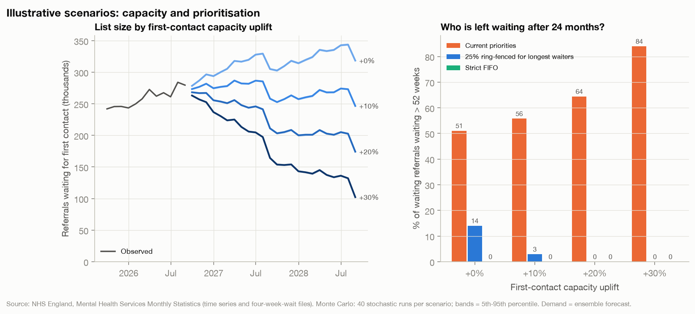
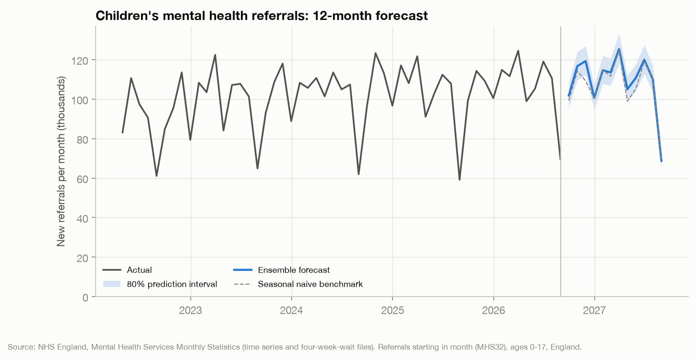
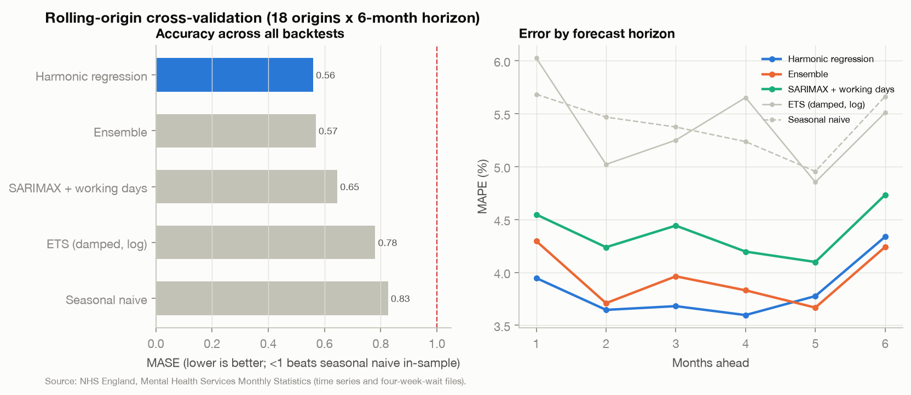
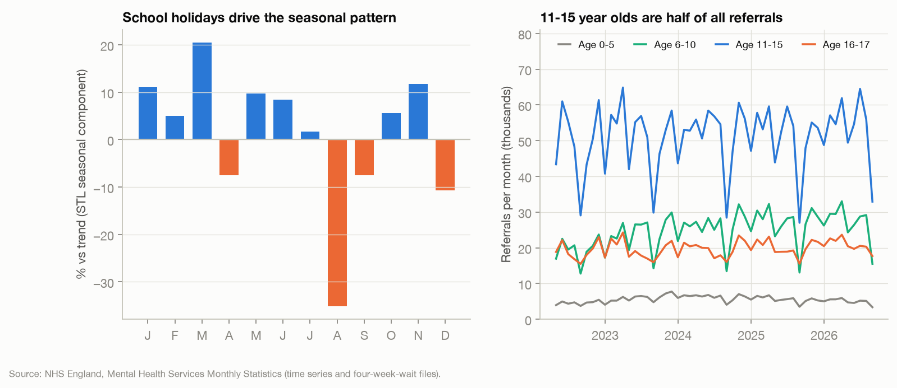
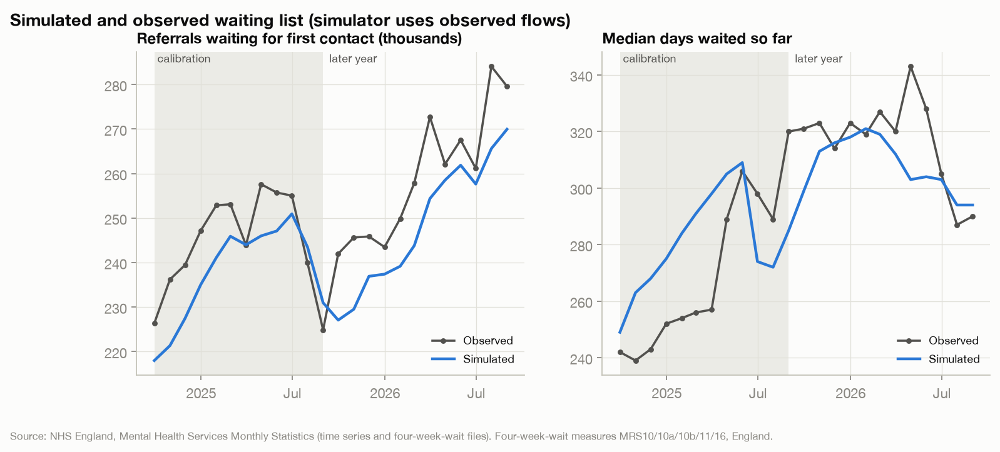

# Forecasting Demand and Simulating the Waiting List for Children's Mental Health Services

[](https://github.com/Abheetsbabbar/children-mental-health-demand-forecasting/actions/workflows/ci.yml)


> How many children will be referred to NHS mental health services next year? And
> how much capacity, and what way of prioritising the waiting list, would bring the
> waits down? This project combines **time-series forecasting** with an
> **illustrative waiting-list simulation**. It uses 53 months of NHS England referral data
> and 29 months of the new children's four-week-wait data.

Part 2 of a three-project portfolio on children and young people's mental health:

| # | Project | Question |
|---|---|---|
| 1 | [Access & inequalities](https://github.com/Abheetsbabbar/children-mental-health-access-inequalities) | Where, and for whom, is access to children's mental-health care unequal? |
| **2** | **Demand forecasting & waiting-list simulation (this repo)** | How many referrals are coming, and what capacity would clear the waiting list? |
| 3 | [Explainable self-harm risk model](https://github.com/Abheetsbabbar/youth-self-harm-explainable-ml) | Which local social factors explain youth self-harm admissions, and which areas exceed expectation? |

---

## Key findings

| | Finding |
|---|---|
| 📈 | **~1.31 million referrals** of under-18s are forecast for Sep 2026 – Aug 2027 (**+2.3%** on the last 12 months). The ensemble forecast has a **4.0% mean error** in 18 rolling backtests, against **5.4%** for the seasonal-naive benchmark (MASE 0.57 vs 0.83). |
| 🏫 | Demand follows the **school calendar**: referrals fall **~35% in August** and dip at Easter and Christmas. 11–15 year olds make up half of all referrals. |
| ⚖️ | The waiting list (**279,604** open referral-spells at Aug 2026) grows because about **70,400** referral-spells arrive each month, while there are about **52,600** first contacts and about 5% of the list closes without contact. A simple steady-state estimate has it settling near **~353,000** at current capacity, and needing **~56,300 first contacts a month (+7%)** to hold level. |
| 🔁 | The real list behaves as if **new referrals are seen first**. The calibrated simulator gives a priority half-life of **~4.6 days**: a referral's chance of being picked halves for every 4.6 days it has waited. This parameter is only weakly identified. **The simulator has no demonstrated predictive skill:** in the later year its median-wait error was 3.4%, against 3.5% for assuming no change, and its 90th-percentile error was 12.1% against 5.4%. The list-size match (4.2%) is partly circular, because exits are derived from the observed list. The model was also revised after looking at that year, so it isn't a clean holdout test. |
| 🚨 | **Illustrative scenarios only:** in this model, adding 30% capacity under newest-first prioritisation shrinks the list to ~102k but leaves **84%** of it waiting over a year. With no extra capacity, reserving 25% of appointments for the longest waiters lowers the share waiting over a year from **51%** to **14%** after 24 months, at the cost of fewer appointments for new referrals. These figures follow from the model's assumptions and are not forecasts. |

<p align="center"></p>

<details>
<summary><b>More figures</b> (forecast, backtest accuracy, seasonality, simulator check)</summary>





</details>

---

## Techniques and technologies

| Area | What was used | Where |
|---|---|---|
| **Data engineering** | Automated scraping of 29 monthly NHS publication pages (choosing Final over Performance files and the latest `_v2` re-issue); a 700 MB, 10-year time series processed in **DuckDB**; a SQL macro that parses **5 inconsistent date formats**; a stock-and-flow identity to derive unpublished exits | [`download.py`](src/demand_forecasting/download.py), [`sql/`](sql/) |
| **Feature engineering** | Working days per month from the **gov.uk bank-holidays API**; month-of-year effects; rolling-to-monthly flow conversion | [`build.py`](src/demand_forecasting/build.py) |
| **Forecasting** | Seasonal-naive benchmark; **ETS** (damped trend, log scale); **SARIMAX** with an exogenous regressor and AIC order selection; **harmonic/dummy regression**; a **geometric-mean ensemble**; 80% prediction intervals | [`models.py`](src/demand_forecasting/models.py) |
| **Evaluation** | **Rolling-origin (expanding-window) cross-validation**, 18 origins × 6-month horizon; **MASE**, MAPE, MAE; prediction-interval **coverage**; order selection on the first window only (no leakage) | [`models.py`](src/demand_forecasting/models.py) |
| **Hierarchical forecasting** | Age-band hierarchy reconciled with **OLS/WLS optimal combination** (Hyndman et al.) and bottom-up | [`models.py`](src/demand_forecasting/models.py) |
| **Time-series decomposition** | **STL** (robust) seasonal decomposition | [`analysis.py`](src/demand_forecasting/analysis.py) |
| **Simulation / operational research** | Daily **discrete-time stochastic queue** tracking each child's wait; priority-weighted capacity allocation (water-filling); **Monte Carlo** (Poisson arrivals and capacity); FIFO, newest-first and ring-fenced policies; fluid steady-state approximation | [`simulate.py`](src/demand_forecasting/simulate.py) |
| **Calibration and checking** | 496-point **grid-search calibration** against observed median/p90 waits on one year, with a parsimony rule; comparison with a **no-change benchmark** on the following year | [`analysis.py`](src/demand_forecasting/analysis.py) |
| **Quality assurance** | **pytest** (conservation laws, known answers, reconciliation coherence); **pandera** data contracts (continuity, identities); **ruff**; **GitHub Actions CI** | [`tests/`](tests/) |

**Stack:** Python 3.11 · DuckDB · pandas · NumPy · statsmodels · SciPy · Matplotlib · pandera · pytest · ruff · GitHub Actions

---

## Repository structure

```
children-mental-health-demand-forecasting/
├── README.md
├── Makefile                      ← make all = download → build → analysis → test
├── pyproject.toml
├── src/demand_forecasting/
│   ├── config.py                 ← sources, horizons, backtest settings
│   ├── download.py               ← NHS time series + 29 monthly 4WW files + bank holidays
│   ├── build.py                  ← DuckDB staging/marts, working-day calendar
│   ├── models.py                 ← forecasting models, backtesting, reconciliation
│   ├── simulate.py               ← waiting-list simulator
│   ├── analysis.py               ← orchestrates everything → figures + results.json
│   └── style.py                  ← shared chart styling
├── sql/
│   ├── 01_staging.sql            ← date-format macro, typed extracts
│   └── 02_marts.sql              ← monthly referrals by age; waiting-list stock & flows
├── data/
│   ├── raw/                      ← downloads (git-ignored)
│   └── processed/                ← monthly series, forecasts, backtest errors, scenarios (committed)
├── reports/
│   ├── figures/
│   └── results.json              ← every number quoted in this README
├── docs/
│   ├── methodology.md
│   ├── data_dictionary.md
│   ├── data_sources.md
│   └── limitations_and_ethics.md
└── tests/
```

## How to run it

```bash
git clone https://github.com/Abheetsbabbar/children-mental-health-demand-forecasting.git
cd children-mental-health-demand-forecasting
python -m venv .venv && source .venv/bin/activate
make install
```

```bash
make all        # download (~60 MB zipped) → build → models + simulation (~1 min) → tests
```

```bash
make analysis   # re-run models and simulation from the committed processed data
```

## Documentation

- [Methodology](docs/methodology.md): data pipeline, model specifications, backtest design, simulator equations, calibration and benchmark check
- [Data dictionary](docs/data_dictionary.md)
- [Data sources and licensing](docs/data_sources.md)
- [Limitations and ethics](docs/limitations_and_ethics.md): what the simulator does and does not represent

## Data and independence

The data is open and aggregate: no patient-level information is used. Copyright ©
NHS England 2026, licensed under the
[Open Government Licence v3.0](https://www.nationalarchives.gov.uk/doc/open-government-licence/version/3/).
This is an independent portfolio project, not endorsed by NHS England or any NHS
organisation. The scenarios are illustrative and are not capacity plans.

**Author:** Abheet Singh Babbar, MSc Data Science, University of Surrey
